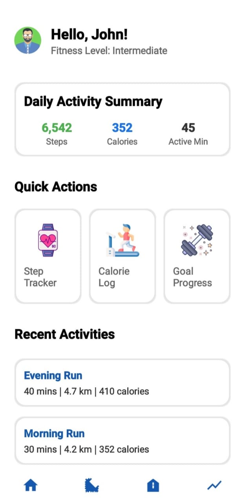
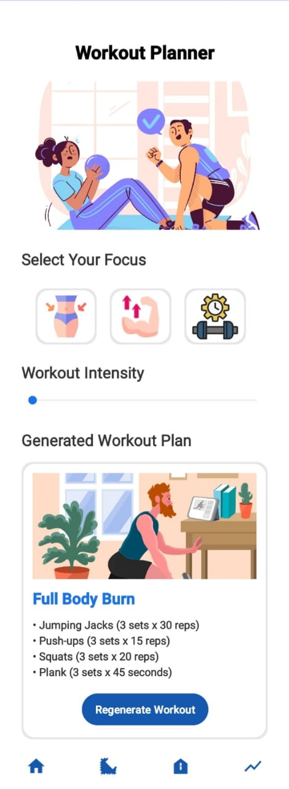
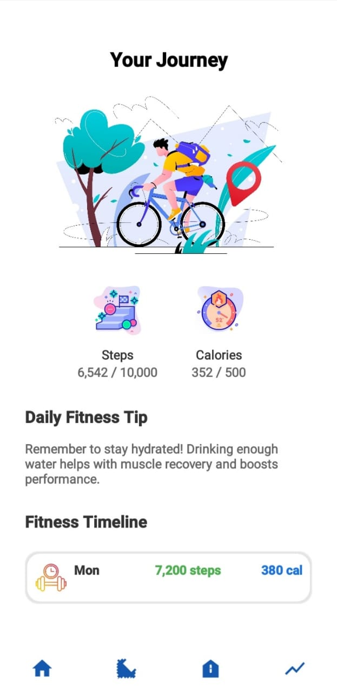

# FitFlow

An Android fitness app prototype with welcome, registration, and sign-in screens.

## Overview

FitFlow is an early-stage project for a personal fitness companion. It is intended for people who want support with their fitness routine. The current implementation focuses on the entry screens: introducing the app and presenting forms for account access.

The repository provides a small example of native Android screen layouts and button handlers for students and developers. It currently contains interface code only. Account creation, credential checking, step counting, calorie tracking, and daily goals are not implemented.

## Key Features

- **Welcome screen:** Fitness artwork, introductory text, and a Get Started button with a handler that attempts to open registration.
- **Registration form:** Full name, email, and password fields, plus a link handler for opening sign-in.
- **Sign-in form:** Email and password fields, plus a link handler for opening registration. Password fields use Android's password input type.

The form buttons attempt to open a home screen without reading, validating, or saving the entered values. The startup and navigation limitations are described under Getting Started.

## Tech Stack

| Area | Technologies |
| --- | --- |
| Language | Kotlin 1.9.24 |
| Android interface | XML layouts, Android Views, AppCompat 1.7.0, ConstraintLayout 2.2.1 |
| Theme | Material Components 1.12.0 with a Material 3 theme |
| Build tools | Gradle 8.10.2, Android Gradle Plugin 8.8.2, Kotlin DSL |

## System Architecture

FitFlow consists of one Android application module, `app`. Each implemented activity loads an XML layout and attaches click listeners to buttons or text links. Those listeners use Android intents to request another screen.

The source defines this intended screen flow:

```text
MainActivity -> SignUpActivity <-> SignInActivity
                     |                 |
                     +-> HomeActivity <-+
                         (placeholder)
```

This flow is incomplete because of the activity configuration issues listed below. There is no backend, authentication provider, database, or network communication. Form data stays in the interface; the activity code does not process or store it.

## Project Structure

```text
FitFlow_Fitness_Tracker/
|-- app/
|   |-- build.gradle.kts          # Android settings and app dependencies
|   `-- src/
|       |-- main/
|       |   |-- AndroidManifest.xml
|       |   |-- java/com/example/fitflow/
|       |   |   |-- MainActivity.kt
|       |   |   |-- SignUpActivity.kt
|       |   |   |-- SignInActivity.kt
|       |   |   `-- HomeActivity.kt
|       |   `-- res/              # Layouts, images, strings, colors, and themes
|       |-- test/                # Starter JVM test
|       `-- androidTest/         # Starter device test
|-- gradle/
|   |-- libs.versions.toml        # Dependency and plugin versions
|   `-- wrapper/                  # Gradle wrapper configuration and JAR
|-- build.gradle.kts              # Shared plugin declarations
|-- settings.gradle.kts           # Project name, module, and repositories
|-- gradle.properties             # Gradle and AndroidX settings
|-- gradlew                       # Unix Gradle launcher
`-- gradlew.bat                   # Windows Gradle launcher
```

The Kotlin files contain screen behavior. The manifest declares Android application components, while `res/layout/` contains the three screen layouts. `HomeActivity.kt` is currently an empty class.

## Getting Started

### Prerequisites

- Android Studio with JDK 21, matching the checked-in IDE configuration.
- Android SDK Platform 35, used for compilation and the target SDK.
- An emulator or device running Android 7.0 / API 24 or later.
- Internet access for the initial Gradle and dependency downloads.

### Installation

Download the repository and open its root folder in Android Studio. Select **Sync Project with Gradle Files** to resolve the dependencies declared in the build files. Use the included Gradle wrapper for command-line builds.

### Environment Configuration

Select your installed JDK 21 as Android Studio's Gradle JDK. For command-line use, set `JAVA_HOME` to that JDK.

Configure the Android SDK through Android Studio. If needed, set its location in a root `local.properties` file using your own path:

```properties
sdk.dir=C:/path/to/Android/Sdk
```

No API keys, service credentials, or application environment variables are required.

### Running the Application

Build a debug APK from the repository root.

Windows PowerShell:

```powershell
.\gradlew.bat :app:assembleDebug
```

macOS or Linux:

```sh
sh ./gradlew :app:assembleDebug
```

To launch through Android Studio, select the `app` run configuration, choose a device or emulator, and click **Run**. However, the current source has these blockers:

- `MainActivity.kt` has no package declaration, while the manifest expects `com.example.fitflow.MainActivity`.
- `SignUpActivity` and `SignInActivity` are missing from the manifest.
- `HomeActivity` does not extend an Android activity, has no screen layout, and is also missing from the manifest.

These issues require source changes before the screen flow can run. The commands follow the checked-in Gradle configuration; builds, tests, and app launch were not executed during this documentation update.


## Screenshots

<p align="left">
  
  
  
  
</p>
